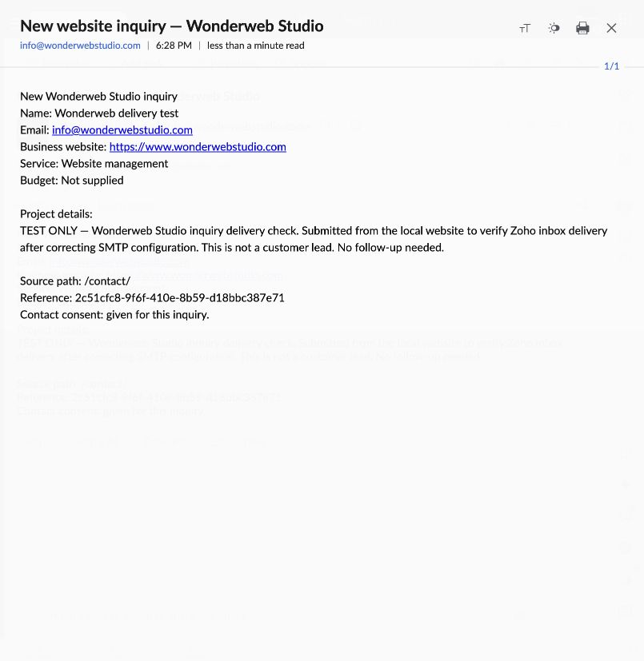
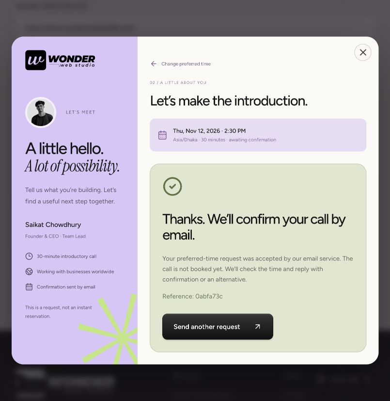

# Zoho inquiry delivery verification — November 11, 2026

All website forms and preferred-time call requests use the shared `/api/inquiry/` handler and the fixed recipient **info@wonderwebstudio.com**. Testing was performed from the local Next.js website, with the user’s authorization to send two clearly labeled test messages.

## Confirmed

- Zoho SMTP authentication succeeded with `smtp.zoho.com:465` (US Mail Free account).
- The inquiry arrived in Zoho Inbox at **6:28 PM Asia/Dhaka**. Its name, website, selected service, message, source path and reference were correct.
- The preferred-time call request arrived at **6:31 PM Asia/Dhaka**. The requested **November 12, 2026, 2:30 PM Asia/Dhaka**, 30-minute duration and REQUESTED status were preserved. No calendar event was created.
- The call submission returned HTTP 200 in 8.4 seconds and the browser displayed the success message.
- Type checking, all 21 automated tests and the production build passed after the final timeout adjustment.

## Issues resolved

1. Next.js environment parsing was changing special characters in the saved SMTP credential. The private file now quotes and escapes the value correctly without changing the credential itself.
2. The initial inquiry reached the inbox, but the previous 12-second deadline expired before its SMTP acknowledgement finished. It was not resent. Delivery now allows 40 seconds overall with a 30-second socket timeout, while the browser waits 55 seconds and the route allows 60 seconds. Success still requires provider acceptance. Logs contain diagnostic codes only.

SMTP cannot guarantee exactly-once delivery: a network failure after acceptance can still leave the delivery outcome uncertain. The message reference helps identify duplicates.

## Evidence

## Production status

These checks verify the **local website → Zoho SMTP → Zoho Inbox** flow. No deployment was performed by the assistant. Production still requires the correct server-only credentials and matching Turnstile keys in the hosting environment, followed by a production test when deployment is authorized. Copy the original credential into a hosting dashboard value field without `.env` wrapping quotes or escaping.
